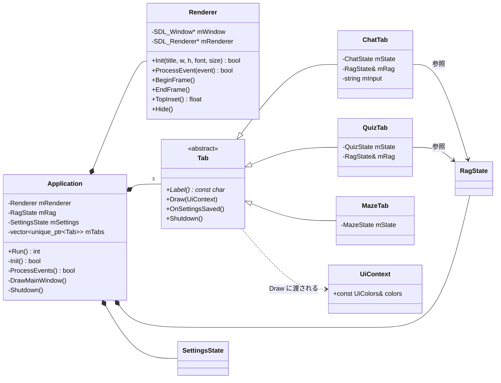

# クラス設計

アプリの土台 (ウィンドウ・メインループ・タブ・ImGui のラッパー) を、どのクラスに分け、なぜそう分けたかをまとめたメモです。
1 つ 1 つの関数の動きは [gui-app.md](gui-app.md)、Python 版との対応は [python-app.md](python-app.md#アプリ本体とタブ) を参照してください。

## 全体像



`main()` は `Application` を作って `Run()` を呼ぶだけです。

```cpp
int main(int, char**)
{
    Application app;
    return app.Run();
}
```

## クラスと責任

| クラス | ファイル | 責任 | 知らないこと |
| --- | --- | --- | --- |
| `Application` | [app/application.h](../src/app/application.h) | 状態の持ち主。起動と終了の順番、イベント待ちのループ、画面全体の枠 (サーバーの状態・設定ボタン・タブバー・設定画面) | SDL と ImGui の初期化の細かいこと、各タブの中身 |
| `Renderer` | [app/renderer.h](../src/app/renderer.h) | SDL のウィンドウとレンダラー、ImGui のコンテキストとバックエンド、フォント、IME のフック。1 フレームの始まりと終わり | 画面に何を描くか (チャットもタブも知らない) |
| `Tab` | [common/tab.h](../src/common/tab.h) | タブの共通の形 (名前・描く・設定の読み直し・終了) | — |
| `ChatTab` / `QuizTab` / `MazeTab` | [chat_ui.h](../src/chat/chat_ui.h) / [quiz_ui.h](../src/quiz/quiz_ui.h) / [maze_ui.h](../src/maze/maze_ui.h) | 自分の状態を持ち、タブの中身を描く。自分のワーカースレッドを止める | ほかのタブ、ウィンドウ、メインループ |
| `UiContext` | [common/tab.h](../src/common/tab.h) | どのタブにも渡すもの (今は画面の色だけ) | — |
| `ui::` のクラスと関数 | [common/widgets.h](../src/common/widgets.h) | ImGui の組で呼ぶ関数を、スコープで閉じるようにする | アプリのこと (ImGui だけに依存する) |

### クラスにしていないもの

会話・クイズ・迷路・RAG・サーバー管理の中身は、これまでどおり **状態の構造体と関数** のままです (`ChatState` と `SendPrompt`、`RagState` と `StartRagIndexing` など)。
ワーカースレッドとロックで状態を共有する作りで、関数ごとにどのスレッドから呼ぶかが決まっているためです。タブのクラスは、これらの構造体を持って関数を呼ぶ「画面の側」だけを受け持ちます。

## 所有と寿命

- `Application` がすべてを持ちます。タブは `std::vector<std::unique_ptr<Tab>>` で持ち、並べた順にタブバーに出します。
- `RagState` はチャットとクイズで共有するので `Application` が持ち、タブには参照で渡します。
  タブより先に作られ、後に壊れるように、`application.h` では **`mRag` を `mTabs` より前に宣言** しています (C++ のメンバーは宣言の逆順に壊れます)。
- `ChatState` などのタブ自身の状態は、タブのメンバーです。タブが壊れるときに一緒に壊れます。
- `Renderer` は、作ったものだけを覚えておく印 (`mSdlInitialized` など) を持ちます。`Init` が途中で失敗しても、デストラクタが作ったものだけを片付けます。
- コピーはしません (`Application` と `Renderer` はコピーを禁止しています)。

## 起動と終了の順番

```
Application::Init
  curl の初期化
  ui.json を読む
  Renderer::Init      … SDL・ウィンドウ・レンダラー・ImGui・フォント・IME
  RegisterWakeEvent / ApplyUiSettings
  タブを作る           … ChatTab (API キーの有無を調べる)・QuizTab・MazeTab
  StartServerManager / StartRagIndexing

Application::Shutdown (Run の最後と、デストラクタから。2 回目は何もしない)
  各タブの Shutdown    … 受信の中断とワーカースレッドの終了待ち
  RAG の中断と終了待ち
  Renderer::Hide       … サーバーの停止に数秒かかるので、先にウィンドウを消す
  StopServerManager
  curl の後始末

メンバーのデストラクタ (宣言の逆順)
  mTabs → mSettings → mRag → mRenderer (ImGui → レンダラー → ウィンドウ → SDL_Quit)
```

ワーカースレッドを止めてから状態を壊すので、スレッドが壊れた状態に触ることはありません。
`Init` が途中で失敗したときも同じ `Shutdown` を通ります (まだ始めていない仕事を止める関数は、何もせずに戻ります)。

## 1 フレームの流れ

```
Application::Run
  ProcessEvents        … Renderer::ProcessEvent (ImGui と IME に渡す)。閉じる操作なら終わる
  Renderer::BeginFrame
  DrawMainWindow
    DrawServerBar      … どのタブでも見えるように、タブの外
    「設定」ボタン
    タブバー            … 選ばれているタブの Draw(context) だけを呼ぶ
    DrawSettings       … 保存されたら、各タブの OnSettingsSaved と ReloadServerManager
  Renderer::EndFrame
```

イベントが無い間は `SDL_WaitEventTimeout` で眠る省電力の仕組みは、`Application` が持ちます ([gui-app.md](gui-app.md#メインループと省電力-applicationrun))。

## ImGui のラッパー (ui::)

ImGui の組で呼ぶ関数 (`BeginDisabled` / `EndDisabled` など) は、`ui::` のクラスでスコープを抜けると閉じるようにしています。一覧は [gui-app.md](gui-app.md#imgui-のラッパー-widgetsh) にあります。

```cpp
{
    ui::Disabled disabled(!settings.managedEnabled);
    ImGui::InputText("チャットのモデル", &settings.managedChatModel);
}   // ここで EndDisabled
```

- コンストラクタに `[[nodiscard]]` を付けています。`ui::Disabled(true);` のように変数に受けずに書くと、その場で閉じてしまうので警告が出ます。
- 閉じる順番は C++ の規則どおり、宣言の逆順です。`ui::Group` → `ui::Id` → `ui::Child` の順に宣言すれば、`EndChild` → `PopID` → `EndGroup` の順に閉じます。
- `ui::StyleColor` は 3 つ目の引数を `false` にすると何もしません。「選んでいるボタンだけ色を変える」を 1 行で書けます。
- ボタンなどを、状態を持つクラスにはしていません。ImGui は毎フレーム描き直す (イミディエイトモード) ので、状態はアプリ側の変数だけに持たせます。クラスにすると、同じ状態を 2 か所に持つことになります。

## 設計で決めたこと

| 決めたこと | 理由 |
| --- | --- |
| `Renderer` と `Application` を分ける | `main()` 1 つに、ライブラリの初期化・状態・ループ・終了の順番が混ざっていたため。`Renderer` だけを見れば SDL と ImGui の扱いが分かり、`Application` だけを見ればアプリの流れが分かる |
| タブが自分の状態を持つ | `DrawUI` に 8 個の引数で状態を渡していたため。タブを足しても `Application` の描く処理は変わらない |
| 共有する `RagState` だけ `Application` が持つ | チャットとクイズの両方が使い、インデックス作成のスレッドはタブと関係なく動くため |
| タブは `Application` が作って持つ (タブが自分を登録しない) | 持ち主を 1 か所にするため。タブがコンストラクタで自分を登録する作りにすると、本体を持つ場所と一覧の 2 か所で寿命を管理することになる |
| `Tab` と `UiContext` は `common/` に置く (`app/` に置かない) | `chat/` などのタブから `app/` を参照しないようにするため。`app/` が各タブを知り、タブは `app/` を知らない |
| `UiContext` を渡す (色を個別の引数にしない) | どのタブにも渡すものが増えたときに、`Tab::Draw` の形を変えずに済むようにするため |
| 終了は `Shutdown()` を明示的に呼び、デストラクタからも呼ぶ | 終了の順番 (ワーカー → RAG → ウィンドウ → サーバー → curl) をデストラクタの順番任せにしないため。2 回呼んでも 1 回だけ動く |
| クラスのメンバー名は `mXxx` | ローカル変数や、状態の構造体のメンバー (`state.busy` など) と区別するため |

## タブを足すには

1. `src/<機能>/` に、状態の構造体とワーカーの関数を作ります (例: `QuizState` と `StartQuiz`)。
2. `Tab` を継承したクラスを作ります。`Label()` と `Draw(const UiContext&)` は必ず、ワーカースレッドを使うなら `Shutdown()` も実装します。
3. `Application::Init` で `mTabs.push_back(std::make_unique<...>(...))` します。並べた順にタブバーに出て、先頭のタブが最初に選ばれます。
4. `CMakeLists.txt` の `add_executable` にソースを足します。
5. Python 版にも同じタブを作るなら、`python/common/tab.py` の `Tab` を継承し、`Application.__init__` の `self._tabs` に足します ([python-app.md](python-app.md#アプリ本体とタブ))。
